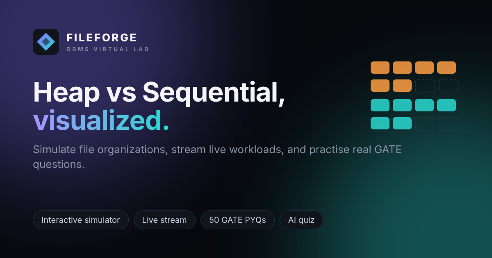

# FILEFORGE — Heap vs Sequential File Organization Lab

An interactive DBMS virtual lab. Insert, search and delete records in a **Heap file** and a **Sequential file** side by side, watch the disk blocks change, stream a live workload, and practise with **50 real GATE CSE questions**, **AI-generated quizzes** (no API key) or **quizzes built from your own PDF notes**.



**Live site:** https://fileforge-dbms.vercel.app/ *(after you enable GitHub Pages — see below)*

---

## Features

| Page | What it does |
| :--- | :--- |
| **Dashboard** | Headline metrics, animated Heap-vs-Sequential growth chart, guided experiments |
| **Simulator** | Insert / search / delete with block-level visuals, Binary Search with `[L] [MID] [R]` pointers, Dual Race Mode, fragmentation & packing factor, step-by-step playback, AI tutor |
| **Analytics** | Comparisons and block accesses, complexity reference, benchmark workload |
| **History** | Save and reload simulations (browser storage) |
| **Live Stream** | Real-time student-records desk: enrolments, look-ups and withdrawals stream into both files; scenarios, live I/O chart, per-operation breakdown |
| **Learn** | 13 concepts with quick checks, linear-vs-binary search visualizer, Formula Lab + GATE index/B+ tree calculator, solved GATE examples, compare table, glossary, printable cheat sheet |
| **Teach** | A video and an article for each organization |
| **Quiz Lab** | Question bank · 50 GATE PYQs (tagged by paper, year, marks, topic) · AI-generated quiz · live-data questions · quiz from your PDF/DOCX/TXT |
| **Help** | Searchable manual, guided tour, getting-started checklist, FAQ, shortcuts |
| **Developed By** | Team and course details |

## Run it locally

No build step and no server needed — it's plain HTML, CSS and JavaScript.

1. Download or clone the repo.
2. Open `index.html` in Chrome, Edge or Firefox.

To serve it over HTTP instead (closer to how it runs online):

```bash
python -m http.server 8000
# then open http://localhost:8000
```

Internet is only needed for the AI quiz and the first time you upload a PDF/DOCX (the reader library loads from a CDN). Everything else works offline.

## Publish it

### GitHub Pages (free, recommended)
1. Push this folder to the `main` branch of `dnvdevx/DBMS_Project`.
2. On GitHub: **Settings → Pages → Build and deployment → Source: Deploy from a branch**, branch **main**, folder **/ (root)** → **Save**.
3. After a minute the site is live at `https://fileforge-dbms.vercel.app/`.

`.nojekyll` and `404.html` are already included.

### Netlify or Vercel
Import the repo and deploy with **no build command** and the **repo root** as the output/publish directory.

> If your URL is different from the GitHub Pages one, update `og:url` and `og:image` near the top of `index.html` so link previews (WhatsApp, LinkedIn, etc.) show the right image.

## Project structure

```
index.html              the app (all pages)
404.html                not-found page for static hosts
manifest.webmanifest    installable-app metadata
css/style.css           core styles
css/ext.css             styles for Quiz Lab, Learn, Help, Live Stream, Developed By
js/helpers.js … main.js simulator core (state, storage, simulation, playback, tutor, workload, history)
js/session.js           intro + student/professional session
js/profile.js           role-based record fields
js/charts.js            dashboard charts
js/questions.js         50 original GATE-style questions
js/pyq.js               50 GATE CSE previous-year questions (tagged)
js/aiquiz.js            key-less AI question generator
js/docquiz.js           PDF/DOCX/TXT reader + question builder
js/quizlab.js           Quiz Lab UI
js/learn.js             Learn tab
js/help.js              Help enhancements
js/realtime.js          Live Stream page
assets/                 favicon, icons, social preview, team photos
samples/                sample_dataset.json (importable), a sample spreadsheet, and a 50-question GATE heap/linear-search paper (DOCX)
docs/                   AI prompt log and test cases
```

## Adding team photos

Photos live in `assets/team/` as `arya.jpg`, `dani.jpg` and `gokul.jpg` (square, about 480×480). To change one, replace the file with the same name. If a photo is ever missing, the card shows the person's initials instead.

## How the quizzes work

- **GATE previous-year questions** are real GATE CSE questions (1994–2026) on file structures & indexing, normalization and transactions. They are re-worded for the app but keep the original parameters, so the official answers hold. Each links to its source listing.
- **AI quiz** uses [Pollinations](https://pollinations.ai)' free, key-less text endpoint. Every returned question is checked (4 distinct options, valid answer) before it's shown; if the service is unavailable the quiz falls back to the built-in bank. AI questions can occasionally be wrong — the bank and GATE sets are verified.
- **Quiz from your files** works with two kinds of document. *Notes* become fill-in-the-blank and true/false questions. *Question papers* — numbered questions with A–D options plus an answer key (or `Answer: B` lines) — are imported and asked exactly as written; questions with no answer or duplicate options are skipped. Try `samples/GATE_CSE_Heap_and_Linear_Search_50_Questions.docx` (50 questions on heaps and linear search). Files are read in your browser ([pdf.js](https://mozilla.github.io/pdf.js/), [mammoth](https://github.com/mwilliamson/mammoth.js)); nothing is uploaded.

## Team

| Name | Register No. | Contribution |
| :--- | :--- | :--- |
| Arya Sengupta | 25BCE1795 | Search algorithms, fragmentation model, AI tutor |
| Dani Noble Varkey | 25BCE1894 | Interface pages, testing, Dual Race Modification, correction of code |
| Gokul Biju | 25BCE1989 | Help manual, testing and documentation |

B.Tech CSE · Database Management Systems · Team 18 · 2026–27

Project documents: [AI prompt log](docs/AI_PROMPT_LOG.md) · [Test cases](docs/TEST_CASES.md)
